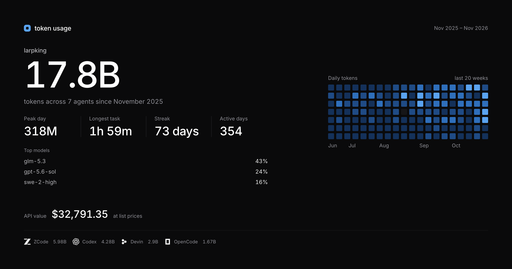
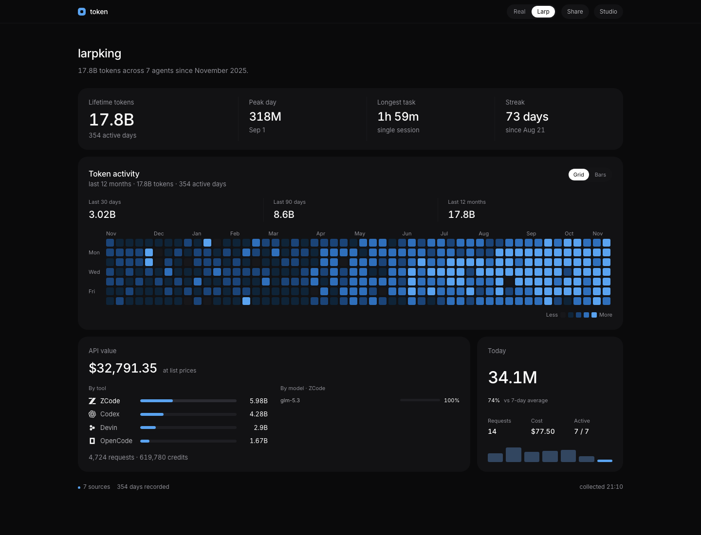

# larpusage

### Your AI usage, as a personality.



Real token usage from the coding agents on your machine. A quiet profile. And a **Larp** mode to compose the usage that happened elsewhere — the other laptop, the old subscription, the tool that never wrote a local log.

**[Open the hosted demo →](https://larpusage.vercel.app)** — Larp mode only. Serverless can't read your laptop.

Built for people who want a receipt, and for people who want a passport.

---

## Why "larp"

Every AI dashboard is a receipt. This one is also a costume.

- **Real mode** reads the session logs your agents already write and shows only what it can prove.
- **Larp mode** lets you add the rest: a provider, a total, a date range, a shape. Or describe it in a sentence and let the generator build the sources.
- Both modes feed the same components. The profile doesn't know which is which.

The page never says "demo", "mock" or "synthetic". The mode switch is the only tell.

---

## What you get



**Profile**
- Lifetime tokens, peak day, longest task, current + longest streak
- 12-month activity grid, quantile-colored
- Weekly bars (`Bars`) for the year
- Global 30-day / 90-day / 1-year totals
- API value at list prices, split **By tool** and **By model**
- Click a tool to see its model split — e.g. Codex → `gpt-5.6-sol 27%`
- Today card: tokens, change vs 7-day average, requests, cost, active days

**Studio**
- Real / Larp switch
- Provider grid: Claude, ChatGPT, OpenCode + **Other** for 20 providers with real logos
- Token input in **M** or **B**, model picker with **Custom model…**
- From / To / shape, live pending cost, live preview
- All 22 GLM models for ZCode / Z.ai, including `glm-5.3-flash`
- One-click remove per source; all sources stay visible

**Share**
- 1200×630 card, exported at **2400×1260**
- Handle, lifetime, peak, longest task, streak, active days
- Top models, API value, provider logos with tokens

---

## Quick start

```bash
npm install
npm run dev
```

Open <http://localhost:4317>. It reads:

```
~/.codex        ~/.claude        ~/.local/share/opencode
~/.qoder        ~/.gemini        ~/.local/share/devin
~/.zcode        …and 15 more
```

Nothing is uploaded. The collector is read-only.

---

## Modes

| | Real | Larp |
|---|---|---|
| Sources | only detected local sessions | local + added sources + backfill |
| Add form | hidden | enabled |
| Purpose | a receipt | a passport |

Switch in the top bar. `Real` ignores every added source, even if one is saved.

---

## Studio

`Cmd+K` or the Studio button. A 1200×748 modal, two panes:

- **Left** — add a provider, tokens, model, dates, shape. The pending cost updates as you type.
- **Right** — live preview (handle, lifetime, grid, API value), the added sources, remove controls.

The add form clears after every source, so you can't accidentally add the same total twice. Exact half-billion totals (`2B`, `500M`) are nudged by under 2% so the profile doesn't look staged.

---

## Adapters

Exact where the tool records it, credits where it doesn't, `—` where nothing exists.

| Tool | Where |
|---|---|
| Codex | `~/.codex/sessions/**/rollout-*.jsonl[.zst]` — `token_usage_record` and older `token_count` |
| OpenCode | `~/.local/share/opencode/opencode.db` — v1 `message` + v2 `session_message` |
| Claude Code | `~/.claude/projects/**/*.jsonl` + subagents |
| Devin | `~/.local/share/devin/cli/sessions.db` — per-request metrics, deduped by request id |
| Qoder | `~/.qoder/projects/**/*.jsonl` — credits |
| Gemini | `~/.gemini/tmp/**/sessions` |
| ZCode | `~/.zcode/cli/db/db.sqlite` when present |
| Cline / Roo / Kilo / Kiro / Cursor / Copilot / Amp / Droid / Goose / OpenClaw / Crush / Kimi / Qwen / Antigravity / Grok | best-effort local readers |

A missing store returns zero events, never an error.

---

## Deploy

```bash
npm run build
npm start
```

**Hosted demo (Vercel):** the public build runs **Larp only**. Serverless can't read your laptop, so `Real` has nothing to scan there. The demo starts from generated history and is meant to show the page, not to track you. Studio edits are ephemeral on the hosted demo.

**Local:** everything works, including Real.

---

## Privacy

- Tokens, model names, timestamps and project paths only.
- No prompt or response text is read or stored.
- No telemetry, no analytics, no account.
- The share image is generated in the browser.

---

## Stack

Next.js 15 · React 19 · Tailwind v4 · `node:sqlite` · `node:zlib` (zstd) · html-to-image · LobeHub provider SVGs.

Not affiliated with OpenAI, Anthropic, Cognition, or any provider shown. Logos identify the tool a number came from; see `THIRD_PARTY_NOTICES.md`.
